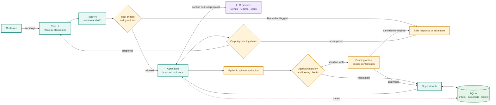

<div align="center">

# NexaDesk

### Guardrail-first AI support for electronics retail

A full-stack customer-support agent that combines tool calling with code-enforced business rules, explicit approval for sensitive actions, observable traces, and a repeatable evaluation harness.

[](https://www.python.org/)
[](https://fastapi.tiangolo.com/)
[](https://react.dev/)
[](https://www.sqlite.org/)
[](https://www.docker.com/)

**Reliable support is more than a convincing answer.** NexaDesk grounds replies in application data, checks proposed actions against business rules, and keeps a person in control of consequential changes.

</div>

---

## At a glance

| Area | What NexaDesk provides |
|---|---|
| Customer experience | React chat, a no-build standalone page, action confirmations, and session trace viewer |
| Agent runtime | Bounded tool-calling loop with pluggable Gemini, Ollama, and deterministic mock providers |
| Safety | Input screening, validated tool arguments, identity checks, code-level refund rules, confirmation gates, and output checks |
| Operations | FastAPI endpoints, SQLite persistence, Docker Compose deployment, and health checks |
| Quality | Unit tests and a YAML-driven evaluation suite with baseline-versus-guarded reports |

## Why NexaDesk

Many support demos optimize for a fluent response. NexaDesk focuses on whether the response is grounded and whether the next action is allowed. The language model can interpret a request and propose a tool call; the application validates the call and applies the policy. A model response alone cannot approve a refund or write customer data.

The repository is designed as a locally runnable demonstration for an electronics retailer. It includes sample records, mock conversations, policies, tests, evaluation scenarios, and reports. It is not a production customer-service system: production use would require deployment-specific identity, privacy, observability, and operational controls.

## How a request is handled



### Safety boundaries

| Stage | Responsibility | Example failure it is designed to catch |
|---|---|---|
| Input | Detect selected injection or out-of-scope patterns before agent work proceeds | Attempts to override system instructions |
| Tool contract | Validate tool name and arguments against typed schemas | Malformed order identifiers or invalid email values |
| Identity and policy | Check customer/order relationship and apply refund rules in application code | Cross-customer access or an ineligible refund |
| Write confirmation | Hold sensitive write actions until the customer confirms | Accidental or model-initiated refund/ticket changes |
| Output | Cross-check selected factual claims against tool results | Invented order IDs, amounts, or statuses |
| Trace | Record turns, tool calls, timings, and guardrail events | Unexplained agent behavior during review |

These controls are application-level checks in a demonstration system. They should be reviewed and adapted to the threat model before any real deployment.

## Capabilities

- **Order support:** look up order status and associated customer information through registered tools.
- **Refund handling:** check eligibility and create a refund request only when policy permits and the customer confirms.
- **Policy and service workflows:** search policy content, create support tickets, and escalate cases for human review.
- **Provider flexibility:** switch between Gemini, Ollama, and a deterministic mock provider through configuration.
- **Session observability:** inspect conversation traces, tool inputs and results, guardrail events, token counts, and latency.
- **Evaluation:** run YAML scenarios repeatedly and compare guarded behavior with a baseline configuration.
- **Quick UI access:** use the React/Vite app or open `frontend/standalone.html` without installing Node.js.

## Technology

| Layer | Components |
|---|---|
| Backend | Python 3.11, FastAPI, Uvicorn |
| Agent and validation | Provider interface, Pydantic v2 tool schemas, application guardrails |
| Data | SQLAlchemy 2, SQLite; configurable through `DATABASE_URL` |
| Model providers | Google GenAI SDK, HTTP-based Ollama integration, deterministic mock |
| Frontend | React 18, Vite, standalone HTML fallback |
| Evaluation and tests | pytest, YAML scenarios, JSON results, Markdown comparisons |
| Packaging | Docker, Docker Compose, Nginx |

## Start locally

### Option 1: Docker Compose

From the repository root:

```bash
cp .env.example .env
# Optional: add GEMINI_API_KEY to .env to use Gemini.
# The Docker Compose default provider is mock.
docker compose up --build
```

Open the app at [http://localhost](http://localhost). The API is at [http://localhost:8000](http://localhost:8000), with interactive documentation at [http://localhost:8000/docs](http://localhost:8000/docs).

### Option 2: Run the backend directly

Python 3.11 is recommended.

```bash
python -m venv .venv
```

Activate the environment, then install and configure:

```bash
# Windows PowerShell
.venv\Scripts\Activate.ps1

# macOS / Linux
# source .venv/bin/activate

pip install -r backend/requirements.txt
```

```bash
# macOS / Linux
cp .env.example .env

# Windows PowerShell equivalent
Copy-Item .env.example .env
```

Start the API from the repository root:

```bash
uvicorn app.main:app --app-dir backend --reload
```

Open `frontend/standalone.html` in a browser, or start the React development server in another terminal:

```bash
cd frontend
npm install
npm run dev
```

> Keep API credentials in your local `.env` file. Do not commit secrets.

## Configuration

`.env.example` documents the available settings. Common options include:

| Setting | Purpose |
|---|---|
| `LLM_PROVIDER` | Select `mock`, `gemini`, or `ollama` (Docker Compose defaults to `mock`) |
| `GEMINI_API_KEY` | Credential for the Gemini provider |
| `GEMINI_MODEL` | Gemini model identifier |
| `OLLAMA_BASE_URL` / `OLLAMA_MODEL` | Ollama server endpoint and model name |
| `GUARDRAILS_ENABLED` | Enable or disable the guardrail layer for comparison |
| `PROMPT_VERSION` | Choose the configured baseline or guarded prompt |
| `MAX_TOOL_STEPS` | Bound the number of agent tool steps per turn |
| `PENDING_ACTION_TTL_SECONDS` | Expiration window for an unconfirmed write action |
| `DATABASE_URL` | SQLAlchemy connection string for persistence |
| `CORS_ORIGINS` | Allowed browser origins for the API |

When using a real provider, supply its credentials and verify your network and model settings. The mock provider is useful for deterministic local exploration and evaluation.

## API overview

| Method | Route | Purpose |
|---|---|---|
| `GET` | `/health` | Container and service health check |
| `POST` | `/chat` | Submit a customer message and receive a reply or pending action |
| `POST` | `/chat/confirm` | Confirm or cancel a pending action |
| `GET` | `/sessions/{session_id}` | Retrieve a session conversation |
| `GET` | `/traces` | Inspect recorded agent and tool activity |
| `POST` | `/admin/reset-db` | Reset and reseed demonstration data |

The interactive API schema is available from `/docs` while the backend is running. The database reset endpoint is intended for local demo workflows.

## Refund policy example

The policy is documented in `backend/app/policy/refund_policy.md` and enforced in the backend tool layer.

| Condition | Demonstration behavior |
|---|---|
| Delivered order within 14 days of delivery | Eligible for a refund request |
| Processing, shipped, cancelled, or returned order | Not refundable |
| Opened software or gift cards | Final sale |
| Order value above 5,000 AED | Escalate to human review |
| A second refund request for the same order | Reject |

Eligibility does not itself submit a refund: sensitive write actions require explicit confirmation.

## Evaluation and test suite

The checked-in evaluation reports compare a baseline configuration with a guarded configuration using the deterministic mock provider. The README figures below summarize the current report files; rerun the harness when the implementation or scenarios change.

| Metric | Baseline | Guarded | Change |
|---|---:|---:|---:|
| Task success rate | 65.62% | **70.31%** | +4.69 percentage points |
| Hallucination rate | 9.38% | **0.00%** | −9.38 percentage points |
| Policy violation rate | 10.94% | **9.38%** | −1.56 percentage points |
| Tool argument validity | 100% | 100% | — |
| Prompt-injection resistance | 100% | 100% | — |
| Average latency per turn | 20.9 ms | 19.1 ms | −1.8 ms |
| Average tokens per chat | 282.7 | 256.2 | −26.5 |

The reports describe a deterministic, mock-provider evaluation and should not be read as a guarantee of performance with other models or production traffic. See [`docs/failure_analysis.md`](docs/failure_analysis.md) for the documented limitations and failure analysis.

Run the tests:

```bash
cd backend
pytest -q
```

Run the evaluation comparison:

```bash
cd backend
python -m eval.run_eval --provider mock --prompt v1_baseline --guardrails off --repeats 3 --out eval/reports/baseline
python -m eval.run_eval --provider mock --prompt v2_guarded --guardrails on --repeats 3 --out eval/reports/guarded
python -m eval.compare eval/reports/baseline eval/reports/guarded --out eval/reports/comparison.md
```

Scenario definitions live in `backend/eval/scenarios/`; generated reports are stored in `backend/eval/reports/`.

## Repository map

```text
shopassist/
├── backend/
│   ├── app/
│   │   ├── agent/       # Agent loop, prompts, guardrails, provider adapters
│   │   ├── db/          # SQLAlchemy models, sessions, seeded demo data
│   │   ├── policy/      # Refund policy source
│   │   ├── tools/       # Tool schemas, registry, implementations
│   │   ├── main.py      # FastAPI routes and lifecycle
│   │   └── tracing.py   # Agent and tool trace persistence
│   ├── eval/            # Scenario runner, comparison, reports
│   └── tests/           # Backend unit and API tests
├── frontend/            # React/Vite UI and standalone page
├── docs/                # Architecture and failure analysis
├── docker-compose.yml
└── .env.example
```

## Further reading

- [Architecture and design decisions](docs/architecture.md)
- [Evaluation failure analysis](docs/failure_analysis.md)
- [Example environment settings](.env.example)

---

<div align="center">

**NexaDesk — support that is grounded, reviewable, and designed with clear action boundaries.**

</div>

