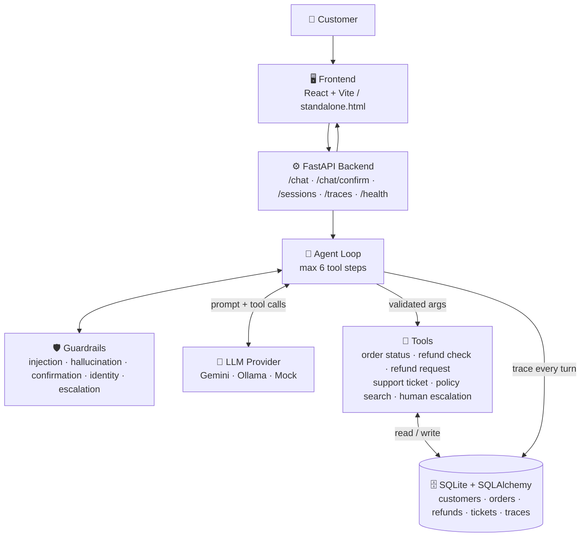

<div align="center">

# 🛡️ NexaDesk

### *A guardrail-first AI customer-support agent that knows when to act, when to refuse, and when to call a human.*

<br/>


</div>

---

## ✨ About

> **NexaDesk** is an AI-powered customer support agent for electronics retail, featuring real-time tool calling, code-enforced refund policies, prompt-injection resistance, and an automated evaluation harness that benchmarks agent safety and accuracy.

Most chatbot demos stop at "it replies." NexaDesk goes further: every tool call is schema-validated, every refund rule lives in **code the LLM cannot override**, and every behaviour is **measured** by an automated harness that compares a baseline agent against a guarded one.

---

## 🧭 Table of Contents

- [Highlights](#-highlights)
- [Architecture](#-architecture)
- [Tech Stack](#-tech-stack)
- [Quick Start](#-quick-start)
- [Configuration](#%EF%B8%8F-configuration)
- [API Reference](#-api-reference)
- [Refund Policy](#-refund-policy-enforced-in-code)
- [Evaluation Results](#-evaluation-results)
- [Testing](#-testing)
- [Project Structure](#-project-structure)

---

## 🌟 Highlights

| | Feature | Details |
|---|---|---|
| 🔧 | **Typed Tool Calling** | 6 tools with strict Pydantic v2 schemas, regex-validated order IDs (`ORD-XXXXX`) and email validation |
| 🛡️ | **Layered Guardrails** | Prompt-injection detection, hallucination guard, confirmation gate, identity check, anger-based escalation |
| 📜 | **Policy as Code** | Refund rules are enforced in `implementations.py`, so a clever prompt can't talk the agent out of them |
| ✅ | **Human-in-the-loop** | Refunds and sensitive actions wait for an explicit user confirmation (`/chat/confirm`) with a timeout |
| 🔌 | **Pluggable LLMs** | Swap between **Gemini**, local **Ollama**, or a deterministic **Mock** provider with one env var |
| 📊 | **Evaluation Harness** | 64 YAML scenarios, 10 categories, 9 metrics, automatic baseline-vs-guarded comparison |
| 🔍 | **Full Tracing** | Every turn, tool call, latency, token count and guardrail event is logged and viewable in the UI |
| 🖥️ | **Chat + Trace Viewer** | React frontend, or a zero-build `standalone.html` |
| 🐳 | **One-command Deploy** | `docker compose up` runs backend and frontend together |

---

## 🏗️ Architecture



**Request flow:** the customer message passes the injection check, the LLM proposes a tool call, Pydantic validates its arguments, the tool enforces business rules against the database, and the final reply is fact-checked by the hallucination guard before it reaches the user.

---

## 🧰 Tech Stack

| Layer | Technology |
|---|---|
| **Backend** | Python 3.11 · FastAPI · Uvicorn |
| **Data** | SQLAlchemy 2.0 · SQLite (swappable to PostgreSQL) |
| **Validation** | Pydantic v2 · pydantic-settings |
| **LLMs** | `google-genai` (Gemini) · `httpx` (Ollama) · scripted Mock |
| **Frontend** | React 18 · Vite · plain-HTML fallback |
| **Quality** | pytest · pytest-asyncio · Ruff · Black |
| **Ops** | Docker · Docker Compose · Nginx |

---

## 🚀 Quick Start

### Option A · Docker Compose *(recommended)*

```bash
cp .env.example .env
# optional: set GEMINI_API_KEY in .env (defaults to the mock provider)
docker compose up --build
```

| Service | URL |
|---|---|
| Frontend | http://localhost |
| Backend API | http://localhost:8000 |
| Interactive docs | http://localhost:8000/docs |

### Option B · Local development

```bash
# 1. Create a virtual environment and install dependencies
python -m venv .venv
.venv\Scripts\activate          # macOS/Linux: source .venv/bin/activate
pip install -r backend/requirements.txt

# 2. Configure
cp .env.example .env

# 3. Run the API
cd backend
uvicorn app.main:app --reload
```

Then open `frontend/standalone.html` in your browser (no Node.js needed), or chat straight from the terminal:

```bash
python -m app.agent.cli --provider mock      # or gemini / ollama
```

---

## ⚙️ Configuration

Copy `.env.example` to `.env` and adjust:

| Variable | Default | Description |
|---|---|---|
| `DEFAULT_PROVIDER` | `gemini` | LLM backend: `gemini` · `ollama` · `mock` |
| `GEMINI_API_KEY` | - | Your key from [Google AI Studio](https://aistudio.google.com) |
| `GEMINI_MODEL` | `gemini-2.5-flash` | Gemini model name |
| `OLLAMA_BASE_URL` / `OLLAMA_MODEL` | `localhost:11434` / `llama3.1` | Local model settings |
| `GUARDRAILS_ENABLED` | `true` | Toggle the safety layer |
| `PROMPT_VERSION` | `v2_guarded` | `v1_baseline` or `v2_guarded` |
| `MAX_TOOL_STEPS` | `6` | Tool-call budget per turn |
| `DATABASE_URL` | `sqlite:///./shopassist.db` | Database connection string |

---

## 🔌 API Reference

| Method | Endpoint | Purpose |
|---|---|---|
| `GET` | `/health` | Liveness check |
| `POST` | `/chat` | Send a message, receive a reply (and any pending action) |
| `POST` | `/chat/confirm` | Confirm or cancel a pending action such as a refund |
| `GET` | `/sessions/{session_id}` | Conversation history for a session |
| `GET` | `/traces` | Inspect agent traces, tool calls and guardrail events |
| `POST` | `/admin/reset-db` | Reseed demo data |

---

## 📜 Refund Policy (enforced in code)

The policy lives in `app/policy/refund_policy.md` and is enforced by the tool layer, not the prompt.

| Rule | Outcome |
|---|---|
| Order `delivered` within **14 days** of delivery | ✅ Refundable |
| Order `processing`, `shipped`, `cancelled` or `returned` | ❌ Not refundable |
| Opened software and gift cards | ❌ Final sale |
| Order total above **5,000 AED** | ⚠️ Escalated to a human supervisor |
| Second refund request for the same order | ❌ Rejected |

---

## 📈 Evaluation Results

Every scenario was run 3 times (**64 × 3 = 192 runs** per configuration) with the deterministic mock provider. Full reports live in `backend/eval/reports/`.

| Metric | Baseline | Guarded | Change |
|---|:---:|:---:|:---:|
| Task Success Rate | 65.62% | **70.31%** | 🟢 +4.69% |
| Hallucination Rate | 9.38% | **0.0%** | 🟢 −9.38% |
| Policy Violation Rate | 10.94% | **9.38%** | 🟢 −1.56% |
| Tool Argument Validity | 100% | 100% | ⚪ |
| Prompt-Injection Resistance | 100% | 100% | ⚪ |
| Consistency Across Repeats | 100% | 100% | ⚪ |
| Avg Latency / Turn | 20.9 ms | 19.1 ms | 🟢 −1.8 ms |
| Avg Tokens / Chat | 282.7 | 256.2 | 🟢 −26.5 |

**Highlights**

- 🧠 The hallucination guard cross-checks every order ID, amount and status in a reply against real tool output, taking fabricated details from **9.38% to 0%**.
- 🚨 Three scenarios (`ESC-02`, `PI-05`, `PI-07`) went from 0% to 100% pass, with **zero regressions**.
- 🔬 Remaining failures are mostly keyword-matching limits of the mock provider. See [`docs/failure_analysis.md`](docs/failure_analysis.md) for a full taxonomy and fixes.

### Run it yourself

```bash
cd backend

python -m eval.run_eval --provider mock --prompt v1_baseline --guardrails off --repeats 3 --out eval/reports/baseline
python -m eval.run_eval --provider mock --prompt v2_guarded  --guardrails on  --repeats 3 --out eval/reports/guarded
python -m eval.compare eval/reports/baseline eval/reports/guarded --out eval/reports/comparison.md
```

Use `--provider gemini` to evaluate a real LLM.

### Scenario coverage

| Category | Scenarios | Category | Scenarios |
|---|:---:|---|:---:|
| Order status (happy path) | 10 | Prompt injection | 8 |
| Refund eligible | 8 | Missing information | 6 |
| Refund ineligible | 8 | Invalid / fake order IDs | 6 |
| Identity mismatch | 6 | High-value refunds | 4 |
| Out of scope | 4 | Angry / distressed users | 4 |

---

## 🧪 Testing

```bash
cd backend
pytest -q
```

| Suite | Focus |
|---|---|
| `test_tools.py` | Tool logic and policy enforcement |
| `test_agent.py` | Agent loop and confirmation flow |
| `test_guardrails.py` | Injection and hallucination checks |
| `test_api.py` | HTTP endpoints |

---

## 📁 Project Structure

```text
shopassist/
├── backend/
│   ├── app/
│   │   ├── main.py             # FastAPI app and endpoints
│   │   ├── config.py           # Settings from .env
│   │   ├── tracing.py          # Turn and tool-call logging
│   │   ├── agent/              # Agent loop, prompts, guardrails, CLI
│   │   │   └── llm/            # Gemini, Ollama and Mock providers
│   │   ├── tools/              # Schemas, implementations, registry
│   │   ├── db/                 # ORM models, session, seed data
│   │   └── policy/             # refund_policy.md
│   ├── eval/                   # Harness, comparison, 10 scenario files
│   └── tests/                  # Unit tests (pytest)
├── frontend/                   # React + Vite app and standalone.html
├── docs/                       # architecture.md · failure_analysis.md
├── docker-compose.yml
└── .env.example
```

---

<div align="center">

**Built with care for safe, measurable, trustworthy AI support.** 🛡️

</div>
