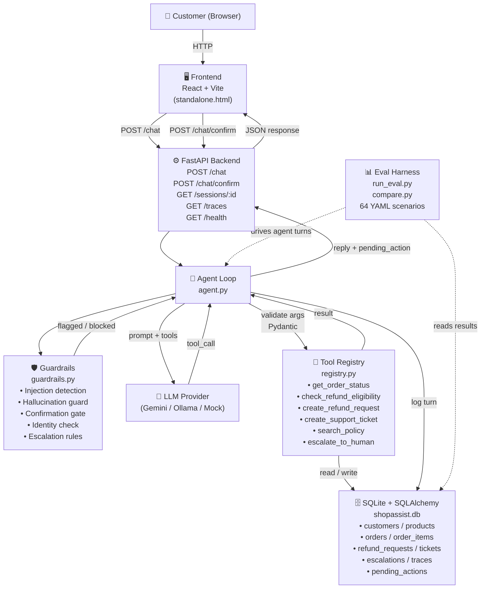
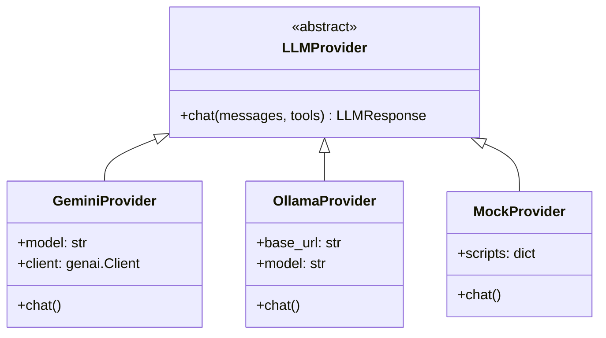
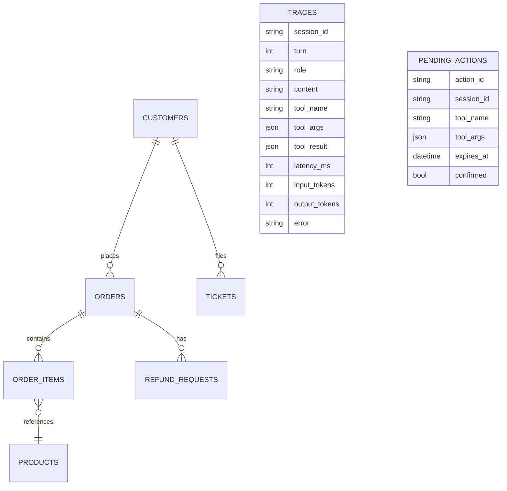
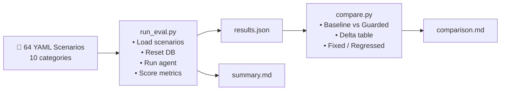

# ShopAssist AI — Architecture

## System Overview

ShopAssist is a full-stack AI customer-support agent for a mock electronics store. It uses tool-calling (function calling) to interact with backend services, enforces a strict refund policy in code, and includes a comprehensive evaluation harness.

## Component Descriptions

### Frontend (`shopassist/frontend/`)
- **React + Vite** SPA (also available as `standalone.html` — no build step required)
- **Chat page**: Message bubbles, tool-call cards (collapsible), Confirm/Cancel buttons for write actions, escalation banner, New Session button
- **Trace viewer**: Per-session timeline of LLM calls, tool calls, latencies, tokens, guardrail events

### FastAPI Backend (`shopassist/backend/app/`)
- **`main.py`**: 7 endpoints with lifespan context, CORS, OpenAPI docs at `/docs`
- **`config.py`**: All settings read from `.env` via `pydantic-settings`; zero hardcoded secrets

### Agent Loop (`app/agent/agent.py`)
1. Load session history from DB
2. Run guardrails on user input (injection, abusive language)
3. Call LLM with system prompt + history + tool schemas
4. If LLM requests a tool → validate args (Pydantic) → check if WRITE tool → gate behind confirmation
5. Execute tool → append result → loop (max 6 tool steps)
6. Run output guardrails (hallucination check)
7. Log everything to `traces` table

### Guardrails (`app/agent/guardrails.py`)
All guards are toggled with `GUARDRAILS_ENABLED` env flag for before/after comparison.

| Guard | Mechanism | Failure Mode Caught |
|-------|-----------|-------------------|
| Injection detection | Regex patterns (`ignore previous`, `you are now`, `act as admin`) | Prompt injection attacks |
| Identity check | Email↔order match in tool code | Cross-customer data access |
| Policy enforcement | Code-level checks in `implementations.py` | LLM refund override attempts |
| Confirmation gate | `pending_action` token, 10-min TTL | Accidental write operations |
| Hallucination guard | Cross-check reply against tool results | Fabricated order IDs/amounts |
| Anger/abuse detector | Keyword + intensity heuristics | Abusive customers needing escalation |
| Out-of-scope detector | Topic heuristics + prompt instructions | Homework / competitor questions |

### LLM Providers (`app/agent/llm/`)

### Data Model

### Evaluation Harness (`shopassist/backend/eval/`)

**9 Metrics measured:**
1. Task Success Rate
2. Tool Selection Accuracy
3. Tool Argument Validity Rate
4. Policy Violation Rate
5. Prompt-Injection Resistance
6. Hallucination Rate
7. Unnecessary Escalation Rate
8. Consistency Across Repeats
9. Average Latency per Turn

## Key Design Decisions

| Decision | Rationale |
|----------|-----------|
| **Policy enforced in code, not only prompt** | LLMs can be manipulated; code cannot be overridden by a prompt injection |
| **MockProvider for tests** | Tests run in milliseconds, never call a real API, are 100% deterministic |
| **SQLite + SQLAlchemy 2.0** | Zero-config persistence; swappable to PostgreSQL by changing `DATABASE_URL` |
| **Pydantic v2 for tool args** | Strict validation with regex, enums, and email format before any DB write |
| **Confirmation gate for WRITE tools** | Prevents accidental or injected data mutations; user must explicitly confirm |
| **Hallucination guard** | Checks every outbound reply against tool results seen in that session |
| **`standalone.html`** | Full-featured frontend that works without Node.js — open in browser while backend runs |
| **Fixed random seed (42)** | Reproducible seed data; deterministic order eligibility windows for eval |
